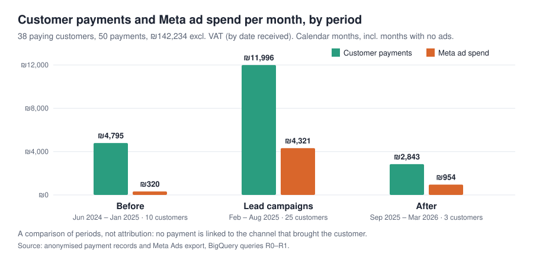

# Case Study 2 — The Missing Link Between Leads and Sales

[← Back to project overview](../README.md)

> **In one sentence:** Meta counted every lead, and my receipts show every payment, but nothing
> connected the two — so I could never tell which advertising, if any, brought my paying customers.

## 1. Business problem

The business model was simple: a free course brought in leads, and each lead was called and offered
a paid training and mentorship programme. Advertising produced 1,923 Meta-attributed leads for
₪39,487. The question I could not answer at the time: **did the advertising bring paying customers,
and at what cost?**

## 2. Relevant data and KPIs

| Source | What it contains | Key figures |
|---|---|---|
| Meta Ads export | daily spend and Meta-attributed leads | ₪39,487 spend · 1,923 leads |
| CRM snapshot | status of 130 leads, reviewed once (29 Apr – 20 May 2025) | 3 meetings scheduled · 34 still in process |
| Payment records | anonymised receipts for the programme, excl. VAT | **38 paying customers · 50 payments · ₪142,234** |

The three sources share **no common key**: no lead ID, ad name or source is stored with a customer.

## 3. Analytical approach

1. **CRM snapshot:** count the 130 leads by status.
2. **Payment reconciliation:** count payments, distinct customers, totals and date range, and check for
   missing values, refunds and payments outside the analysed periods (query R0).
3. **Period comparison:** split the timeline into before, during and after the lead campaigns, and
   compare average monthly payments with average monthly ad spend (query R1). The lead-campaign
   period is February – August 2025, the only months with lead-objective spend.

## 4. Key findings

**The CRM snapshot shows a weak step after the lead.**

| Status (130 leads) | Count |
|---|---:|
| Disqualified | 43 |
| Unreachable | 36 |
| Still in process | 34 |
| Other / blank | 14 |
| Meeting scheduled | **3 (2.3%)** |

**Payments were higher while the lead campaigns ran — but the timing is all the data shows.**

| Period | Months | Payments per month | Ad spend per month | Paying customers |
|---|---:|---:|---:|---:|
| Before (Jun 2024 – Jan 2025) | 8 | ₪4,795 | ₪320 | 10 |
| Lead campaigns (Feb – Aug 2025) | 7 | ₪11,996 | ₪4,321 | 25 |
| After (Sep 2025 – Mar 2026) | 7 | ₪2,843 | ₪954 | 3 |

- Monthly payments were about **2.5× higher** during the lead campaigns than before them.
- Sales were already coming in before the campaigns: ₪38,360 with only ₪2,560 of ad spend, through
  word of mouth and personal calls.
- During the campaigns we also tried to call every lead, so advertising and sales effort rose together.
- **No payment is linked to a channel.** The central finding is not a number but a gap: the customer
  journey was never measured end to end.

## 5. Supporting visualization



## 6. Business implications and proposed decisions

- **Record the source of every lead and every customer** (ad, webinar, referral or call) — the single
  change that would make cost per customer measurable by channel.
- **Track each lead's journey** in the CRM: called, meeting scheduled, meeting held, sale, amount.
- **Steer by cost per scheduled meeting**, not cost per lead, once the journey is tracked.
- For scale only: the payments of about 11 average customers (₪142,234 ÷ 38 = ₪3,743 each) equal the
  total ad spend. This is **gross money in, not profit or break-even**: course delivery, mentorship and
  sales costs are excluded, and nothing shows the ads brought those customers.

## 7. Limitations

- **No attribution.** Payments cannot be linked to ads, so there is **no CAC or ROAS**; the period
  comparison shows association in time, not cause.
- **One CRM snapshot.** 130 leads reviewed once; 34 were still open and may have progressed later.
  "Scheduled" does not mean the meeting took place. 2.3% should not be read as the rate for all leads.
- **Cash basis.** Payments are counted when received, so an instalment plan appears in several months.
- **Customer count.** An earlier business record indicated 46 students; it could not be reconciled
  with the payment dataset, so the financial analysis uses the 38 customers in the payment records.
- Calendar months include months with no ads (5 of 8 before, 2 of 7 after) or no payments.

## 8. Relevant SQL

**Queries R0, R1 and R2** in [`The_Data_I_Had_SQL.sql`](../The_Data_I_Had_SQL.sql#L328-L444) — BigQuery.

*What R1 does in plain English:* defines the three periods, adds up payments and paying customers in
each period, adds up ad spend in each period, and divides both by the number of calendar months.

```sql
WITH periods AS (
  SELECT '1. Before lead campaigns' AS period, DATE '2024-06-01' AS start_date, DATE '2025-01-31' AS end_date
  UNION ALL SELECT '2. Lead campaigns',       DATE '2025-02-01', DATE '2025-08-31'
  UNION ALL SELECT '3. After lead campaigns', DATE '2025-09-01', DATE '2026-03-31'
),
revenue AS (
  SELECT p.period, SUM(pay.amount_ils) AS revenue_ils, COUNT(DISTINCT pay.customer_id) AS paying_customers
  FROM periods AS p
  JOIN `bqproj26.meta_ads.student_payments` AS pay
    ON pay.payment_date BETWEEN p.start_date AND p.end_date
  GROUP BY p.period
),
ad_spend AS (
  SELECT p.period, SUM(ads.spend_ils) AS ad_spend_ils
  FROM periods AS p
  JOIN `bqproj26.meta_ads.v_ads_daily` AS ads
    ON ads.day BETWEEN p.start_date AND p.end_date
  WHERE ads.is_active
  GROUP BY p.period
)
SELECT
  p.period,
  DATE_DIFF(p.end_date, p.start_date, MONTH) + 1 AS months,
  ROUND(SAFE_DIVIDE(r.revenue_ils,  DATE_DIFF(p.end_date, p.start_date, MONTH) + 1)) AS payments_per_month_ils,
  ROUND(SAFE_DIVIDE(a.ad_spend_ils, DATE_DIFF(p.end_date, p.start_date, MONTH) + 1)) AS ad_spend_per_month_ils,
  r.paying_customers
FROM periods AS p
JOIN revenue AS r USING (period)
LEFT JOIN ad_spend AS a USING (period)
ORDER BY p.period;
```

Customer names were replaced by anonymous IDs before the payments were loaded
([`prepare_payments.py`](../prepare_payments.py)) and the file was checked before use
([`check_payments.py`](../check_payments.py)).
