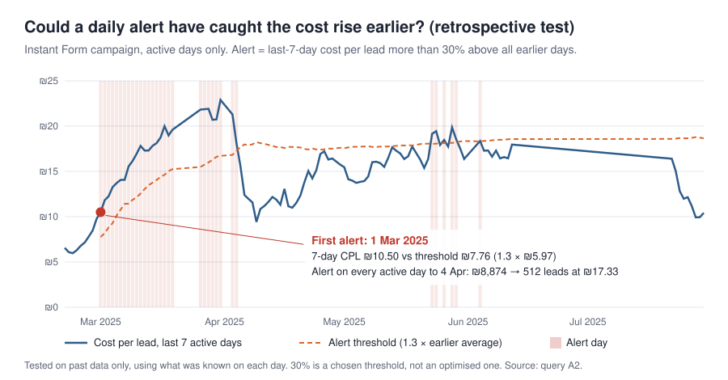

# Case Study 3 — Could I Have Detected Rising CPL Earlier?

[← Back to project overview](../README.md)

> **In one sentence:** a simple daily rule, tested retrospectively on my own history, would have
> flagged the March 2025 cost rise on **1 March** — about a month before a monthly report for
> March could show it.

## 1. Business problem

In March 2025 the Instant Form cost per lead jumped from ₪8.78 (February) to ₪17.76. A monthly
report shows a jump like that only after the month has ended — after the money has been spent. The question: **could a simple daily check have warned me earlier?**

## 2. Relevant data and KPIs

- Meta Ads daily export, Instant Form campaign, **111 active days** (days with spend), 20 Feb – 30 Jul 2025.
- **7-day CPL:** spend ÷ leads over the last 7 *active* days (days without spend are skipped).
- **Benchmark CPL:** spend ÷ leads over **all earlier active days** — only data that existed on that
  day, so the test never looks into the future.
- **Alert threshold:** benchmark × 1.3.

## 3. Analytical approach

The rule, fixed before running the test:

> Alert when the 7-day CPL is **more than 30% above** the benchmark CPL — once the window has 7 active
> days and the benchmark is based on at least 100 earlier leads.

- **Rolling window:** a SQL window function sums spend and leads over the current active day and the
  6 before it.
- **Benchmark:** a second window function sums everything from the first day up to 7 active days earlier.
- **Why 30%:** chosen in advance as a simple, round threshold meaning "clearly worse than usual".
  It was not optimised, and no other threshold was tested.

## 4. Key findings

- **First alert: 1 March 2025.** The 7-day CPL was **₪10.50**, against a benchmark of ₪5.97
  (threshold ₪7.76).
- The alert then stayed on **every active day until 4 April** — 27 active days in which
  **₪8,873.80 bought 512 leads at ₪17.33** each.
- After that, only four short episodes of 1–2 active days in late May and early June (6 days in total).
- The information needed to react existed about a month before the monthly view could show it.

## 5. Supporting visualization



The blue line is the actual 7-day CPL; the dashed line is the threshold; shaded bands are alert days.
The full daily series behind the chart is in [`results/cs3_alert_daily_series.csv`](../results/cs3_alert_daily_series.csv).
The live dashboard contains the same alert as an interactive chart.

## 6. Business implications and proposed decisions

An alert should trigger **an investigation, not an automatic action**:

1. **Same day:** check which step moved — CPM, CTR or the click-to-lead rate (see Case Study 1).
2. **If it persists for 3 days:** refresh the creative or test a new audience.
3. **Weekly:** review whether budget should move between offers.

The 30% threshold and the 3-day rule are **starting points to validate on new data**, not proven settings.

## 7. Limitations

- **A retrospective backtest, not a validated predictive model.** It shows the rule would have fired on
  past data; it does not show how it would perform in the future or how I would have acted.
- **One threshold.** Only 30% was tested; false alarms and missed rises were not formally measured,
  beyond noting the short May–June episodes.
- **Active days only.** Pauses in the campaign are skipped, so a 7-day window can span more than 7
  calendar days.
- **Meta-attributed leads,** and a single campaign recorded under one ad name.

## 8. Relevant SQL

**Query A2** in [`The_Data_I_Had_SQL.sql`](../The_Data_I_Had_SQL.sql#L283-L326) — BigQuery.

*What it does in plain English:* builds one row per active day for the Instant Form campaign, uses two
window functions to sum the last 7 active days and all earlier days, and lists every day on which the
7-day CPL was more than 30% above the earlier average.

```sql
WITH daily AS (
  SELECT day, SUM(spend_ils) AS spend, SUM(leads) AS leads
  FROM `bqproj26.meta_ads.v_ads_daily`
  WHERE is_active
    AND objective = 'actions:leadgen.other'          -- Instant Form campaign
  GROUP BY day
),
rolling AS (
  SELECT
    day, spend, leads,
    COUNT(*)   OVER (ORDER BY day ROWS BETWEEN 6 PRECEDING AND CURRENT ROW)         AS days_in_window,
    SUM(spend) OVER (ORDER BY day ROWS BETWEEN 6 PRECEDING AND CURRENT ROW)         AS spend_7,
    SUM(leads) OVER (ORDER BY day ROWS BETWEEN 6 PRECEDING AND CURRENT ROW)         AS leads_7,
    SUM(spend) OVER (ORDER BY day ROWS BETWEEN UNBOUNDED PRECEDING AND 7 PRECEDING) AS spend_before,
    SUM(leads) OVER (ORDER BY day ROWS BETWEEN UNBOUNDED PRECEDING AND 7 PRECEDING) AS leads_before
  FROM daily
)
SELECT
  day,
  ROUND(SAFE_DIVIDE(spend_7, leads_7), 2)           AS cpl_last_7_days,
  ROUND(SAFE_DIVIDE(spend_before, leads_before), 2) AS cpl_before,
  ROUND(spend, 2)                                   AS spend_that_day,
  leads                                             AS leads_that_day
FROM rolling
WHERE days_in_window = 7
  AND leads_before >= 100
  AND SAFE_DIVIDE(spend_7, leads_7) > 1.3 * SAFE_DIVIDE(spend_before, leads_before)
ORDER BY day;
```

The chart is drawn by [`make_case_study_charts.py`](../make_case_study_charts.py), which recalculates
the rolling series from the same export and stops unless it reproduces the BigQuery result exactly
(33 alert days; 27 days, ₪8,873.80 and 512 leads in the first episode).
