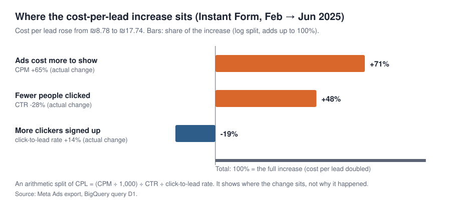

# The Data I Had, But Didn't Know How to Use

**A Data Analyst portfolio project on my own business's real data** · Sun Sahar

I ran a small trading-education business. Meta ads brought in plenty of leads, but costs kept
rising and too few leads became paying customers. At the time I judged results mainly by lead
count and cost per lead. Here I went back to the data to find out what it could have told me —
and what it never could.

**[📊 Presentation (PDF)](The_Data_I_Had.pdf)** ·
**[📈 Live dashboard](https://datastudio.google.com/reporting/517f4b3d-41fb-49b6-b738-0b5f93a7f9a8)** ·
**[🧮 SQL](The_Data_I_Had_SQL.sql)** ·
**[📄 The story behind the project](The_Story_Behind_the_Project.pdf)**

---

## Business problem

Leads were cheap at first, then doubled in price, and the step from lead to sale was barely
measured. Three questions drive the project:

1. **Why did leads get more expensive?**
2. **Why didn't more leads become paying customers — and could I tell which advertising worked?**
3. **Could I have seen the problem earlier?**

## Data and verified metrics

| Data | Scope | Verified figures |
|---|---|---|
| Meta Ads daily export (2 ad accounts) | Jun 2024 – Jan 2026 | ₪39,487 spend · 1,923 Meta-attributed leads · ₪15.28 per lead (lead campaigns) |
| Payment records (anonymised) | Jun 2024 – Mar 2026 | 38 paying customers · 50 payments · ₪142,234 excl. VAT |
| CRM snapshot | 130 leads, reviewed once (Apr–May 2025) | 3 meetings scheduled · 34 still in process |

The ad export held 92,028 rows, but 99% were zero-spend padding; only the 595 ad-days with spend
are activity. Every rate is calculated from totals (sum ÷ sum), never by averaging daily rates.

**Tech stack:** BigQuery SQL (CTEs, window functions) · Python (cleaning, anonymisation, checks) ·
Looker Studio (dashboard)

---

## Case studies

### 1 · [Why did my leads get more expensive?](case-studies/01-why-leads-got-more-expensive.md)

Cost per lead doubled from ₪8.78 to ₪17.74 (Feb → Jun 2025). An exact log split shows **most of
the increase happened before the click**: ads cost 65% more to show and the click rate fell 28%,
while the share of clickers who signed up rose 14%.

### 2 · [The missing link between leads and sales](case-studies/02-the-missing-link-between-leads-and-sales.md)

Monthly payments were about **2.5× higher** while the lead campaigns ran — but sales were already
coming in before them, and **no payment is linked to the channel that brought the customer**. The
real finding is a measurement gap: the customer journey was never tracked end to end.

### 3 · [Could I have detected rising CPL earlier?](case-studies/03-could-i-have-detected-rising-cpl-earlier.md)

A simple daily rule — 7-day cost per lead more than 30% above all earlier days — tested
retrospectively, would have fired on **1 March 2025**, about a month before a monthly report.
While it stayed on, ₪8,874 bought 512 leads at ₪17.33.

---

## Recommendations

- **Measure the full journey:** tag every lead and customer with its source, and record called →
  meeting scheduled → meeting held → sale.
- **Steer by cost per scheduled meeting,** not cost per lead.
- **Investigate before the click first** when costs rise: creative and audience tests.
- **Add a daily cost-per-lead check** that triggers an investigation, with thresholds validated on new data.
- **Name every creative uniquely,** so tests can show what worked.

## Limitations

- No payment is linked to an ad, so there is **no CAC, ROAS or profit** figure; period comparisons
  show timing, not cause.
- The meeting rate comes from **one CRM snapshot** of 130 leads.
- The alert is a **retrospective backtest** with one chosen threshold, not a validated predictive model.
- An earlier business record of 46 students could not be reconciled with the payment data; all
  payment figures use the 38 customers in the payment records.

---

## How this project was built

This project was built with **AI-assisted development**. AI tools wrote the SQL and Python. I
supplied the business context and the data, helped define and refine the research questions, ran
the queries in BigQuery, built the dashboard with guidance, challenged results that did not match
the business, and interpreted the findings.

## Repository contents

| File | What it is |
|---|---|
| [`The_Data_I_Had.pdf`](The_Data_I_Had.pdf) | the full presentation (9 slides + appendix) |
| [`The_Story_Behind_the_Project.pdf`](The_Story_Behind_the_Project.pdf) | the business context in three pages |
| [`case-studies/`](case-studies/) | the three case studies |
| [`The_Data_I_Had_SQL.sql`](The_Data_I_Had_SQL.sql) | every BigQuery query, in story order, each with question, method and result |
| `prepare_ads.py` | cleans the two Meta Ads exports and checks the totals |
| `retrospective_audit.py` | sums spend and leads by objective, month and lead type |
| `check_aggregate_consistency.py` | cross-checks the earlier summaries (283 of 284 checks pass; one ₪0.01 rounding gap) |
| `prepare_payments.py` | turns the receipts export into an anonymous payments file |
| `check_payments.py` | checks the payments file: counts, dates, periods |
| `make_case_study_charts.py` | draws the three charts and checks every figure against the BigQuery results |
| [`results/`](results/) | the daily alert series behind Case Study 3 (aggregate data) |

## Privacy

No customer names, contact details or identifiable payment records are in this repository. The raw
exports are private; the SQL runs against the private BigQuery dataset `bqproj26.meta_ads`.
